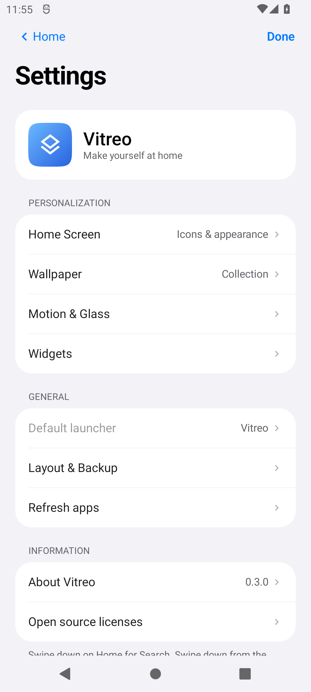

# Vitreo Launcher 0.4.1

Un inicio Android inspirado en la pantalla de inicio actual de iOS y en
[Folio](https://github.com/McCal-Codes/folio), con una interfaz más pequeña y directa.
Android 12 o posterior, sin root, cuentas, anuncios ni telemetría.

<p>
  
  
  
  
  
</p>

Capturas reales del APK Preview en Android 12 (inicio/ajustes) y Android 15 (biblioteca/menús/widgets).
El [icono instalado](docs/screenshots/app-icon.png) llena la máscara circular sin un recuadro interior.

## La experiencia

La interfaz está en inglés por defecto.

- **Icono de la APK:** fondo adaptativo completo y marca sin recuadro; recurso circular y soporte de iconos monocromáticos.
- **Inicio:** cuatro columnas, iconos con esquinas continuas y un dock de cristal de cuatro plazas.
- **Widgets de inicio:** reloj analógico y calendario con la fecha real, que puedes mostrar u ocultar.
- **Hoy:** desliza a la derecha. Sugerencias basadas en las apps que abres desde Vitreo y widgets reales de tus apps Android.
- **Spotlight:** toca Search o desliza hacia abajo. Búsqueda local por nombre o paquete, con acceso inmediato al teclado.
- **Biblioteca de apps:** después de la última página. Grupos automáticos, categorías ampliables y búsqueda en lista alfabética con índice lateral.
- **Catálogo:** accesos del usuario Android actual obtenidos mediante LauncherApps, incluidos iconos alternativos activados por las apps. Cambiar de icono conserva su posición cuando apunta a la misma actividad.
- **Apps y menús:** apertura desde el icono real en todas las vistas. Al regresar con Atrás o HOME se recupera la carpeta, categoría o búsqueda; otro HOME vuelve al inicio. Mantén pulsado un icono para levantarlo y ver un menú anclado, acciones adicionales y los accesos rápidos que publique esa app.
- **Movimiento:** paneles con apertura y salida al origen; arrastra hacia abajo desde su cabecera para cerrar o suelta antes para cancelar. Los ajustes de movimiento reducido y ahorro de batería siguen activos.
- **Carpetas:** panel central de cristal, cuadrícula de tres por tres, páginas y nombre editable.
- **Edición:** mantén pulsado un espacio libre, o elige Edit Home Screen en el menú de un icono. Los iconos se mueven suavemente; puedes reordenarlos, moverlos entre páginas manteniéndolos junto al borde y cambiarlos con los del dock. Mantén una app sobre otra para crear una carpeta o añadirla a una existente.
- **Personalización:** iconos claros, oscuros, tintados o de cristal; arte propio para las funciones comunes y opción de conservar los iconos de las apps; aspecto claro, oscuro o automático; cuatro fondos originales y fotos locales.
- **Fotos:** editor con pellizco y arrastre, Fit para ver la foto entera sobre una extensión desenfocada, Fill, Reset y guardar/cancelar. Conserva el original y permite reajustarlo.
- **Widgets:** selector con búsqueda y previsualizaciones reales del proveedor (diseño o imagen); indica cuándo una app no suministra ninguna.
- **Ajustes:** listas agrupadas, vistas previas, navegación animada, controles segmentados e interruptores al estilo iOS. Motion & Glass permite ajustar escarcha, refracción y accesibilidad; Wallpaper permite oscurecer el fondo. Se abren desde la rueda de Hoy o desde el modo edición.
- **Centro de control:** desliza hacia abajo desde la zona superior derecha del inicio. Accesos funcionales a Internet, Bluetooth, sonido y pantalla, además del aspecto y widgets de Vitreo.

El sistema mantiene su teclado, pantalla de bloqueo, notificaciones y Recientes.
Los controles de conectividad y sonido abren los paneles de Android. Los widgets
nativos se añaden a Hoy mediante la autorización del sistema; sus IDs pertenecen
a esta instalación y no se incluyen en copias portables.

## Instalar y actualizar

Descarga la APK firmada en [Releases](https://github.com/sPROFFEs/vitreo-launcher/releases).
La identidad de release es `dev.vitreo.launcher`. La versión 0.4.1 conserva la firma
anterior y sube el versionCode a 401: se puede actualizar sin desinstalar ni perder
la distribución. Las copias de 0.1.0 siguen siendo compatibles.

Preview (`dev.vitreo.launcher.preview`) y Debug (`dev.vitreo.launcher.debug`) son
apps separadas. Preview usa una firma temporal del entorno de pruebas.

Si falta una app, prueba Settings → Refresh apps y búscala por nombre o paquete
en Search. La lista corresponde al usuario Android actual; todavía no combina
perfiles de trabajo, Carpeta Segura ni Espacio Privado. Motion & Glass muestra
cuándo el ahorro de batería, Reducir movimiento o Reducir transparencia limitan
el efecto. El fondo aporta el detalle que se refracta: una foto con textura hace
el borde más visible que un color uniforme.

## Compilar y publicar

Con JDK 17 y SDK Android 35:

```bash
bash gradlew --no-daemon :app:testDebugUnitTest :app:lintDebug :app:assembleDebug :app:assemblePreview
python3 scripts/check_project.py
python3 -m unittest discover -s tests -v
```

`Release APK` se ejecuta al subir a `main`. Comprueba fuente y firma configurada,
prueba emuladores API 31 y 35, compila la release optimizada y verifica identidad,
permisos, certificado y hashes antes de publicarla. Solo publica una APK con los
cuatro secrets privados de firma. Las versiones numéricas se publican como releases
normales; GitHub elige `Latest` por versión. Preview se distribuye como artifact
de CI. Consulta [BUILDING.md](BUILDING.md) y
[SIGNING.md](docs/SIGNING.md).

Para la siguiente versión:

```bash
python3 scripts/bump_version.py 0.4.2
git add app scripts version.properties README.md CHANGELOG.md
git commit -m "Update Vitreo"
git push origin main
```

Los assets publicados son inmutables: cada revisión utiliza una versión nueva.

## Diseño, privacidad y procedencia

La referencia visual es [iOS](https://www.apple.com/os/ios/) y sus controles
Liquid Glass ([UIKit](https://developer.apple.com/documentation/uikit/uiglasseffect) y [materiales](https://developer.apple.com/design/human-interface-guidelines/materials)), la referencia visual de [liquid-glass.pro](https://www.liquid-glass.pro/), junto con las interacciones de [Folio](https://github.com/McCal-Codes/folio).
Vitreo dibuja sus propios fondos y materiales y utiliza el arte de las aplicaciones
instaladas. La geometría, los roles de movimiento y el anclaje de menús adaptados de Folio conservan su licencia y atribución en
[THIRD_PARTY_NOTICES.md](THIRD_PARTY_NOTICES.md).

El cristal se dibuja directamente en Compose, con un shader Android propio y sin una vista Android adicional por panel: no usa UIKit ni captura otras aplicaciones. Solo procesa el fondo propio del launcher. Los controles usan un acabado transparente y las carpetas/categorías un material más denso con texto adaptado al tema. Los reflejos de pulsación no crean un bucle de renderizado en reposo. Android controla las transiciones entre tareas y Recientes; Vitreo coordina su escritorio y entrega el origen del icono al sistema. No sustituye el compositor de iOS ni ofrece control total de las ventanas de otras apps. Los datos se conservan en
el dispositivo. El único permiso específico de esta versión es la vinculación
opcional de widgets a través del diálogo de Android. Más detalles en
[PRIVACY.md](PRIVACY.md). Licencia MIT.
