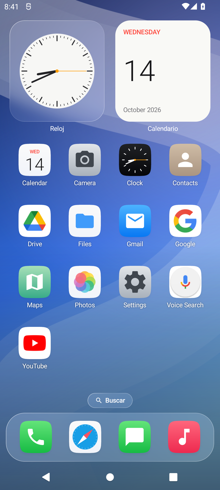
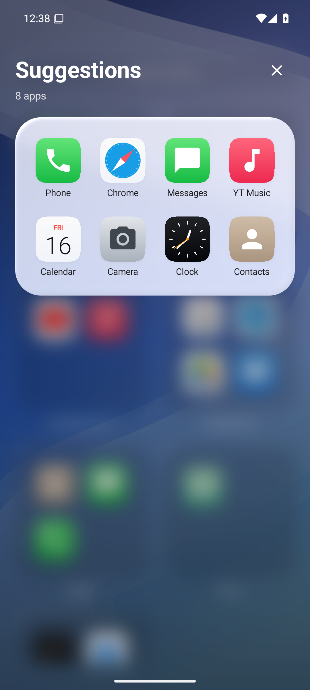
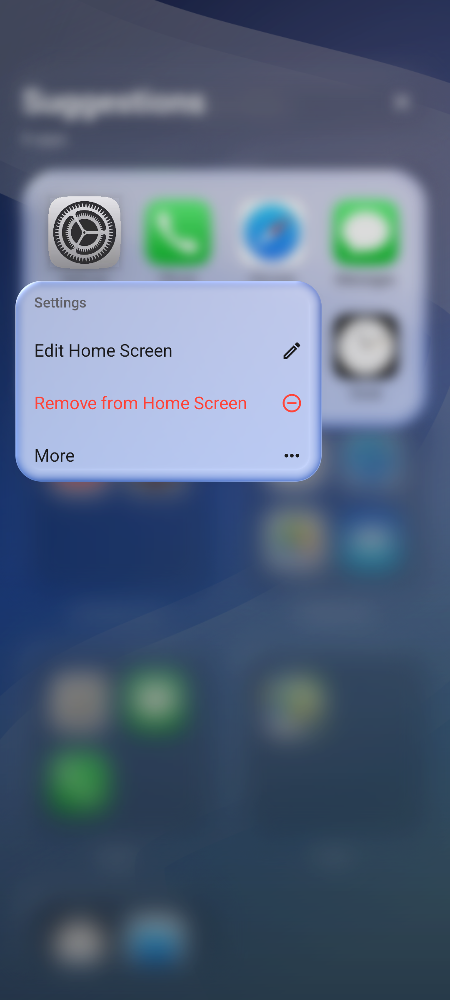
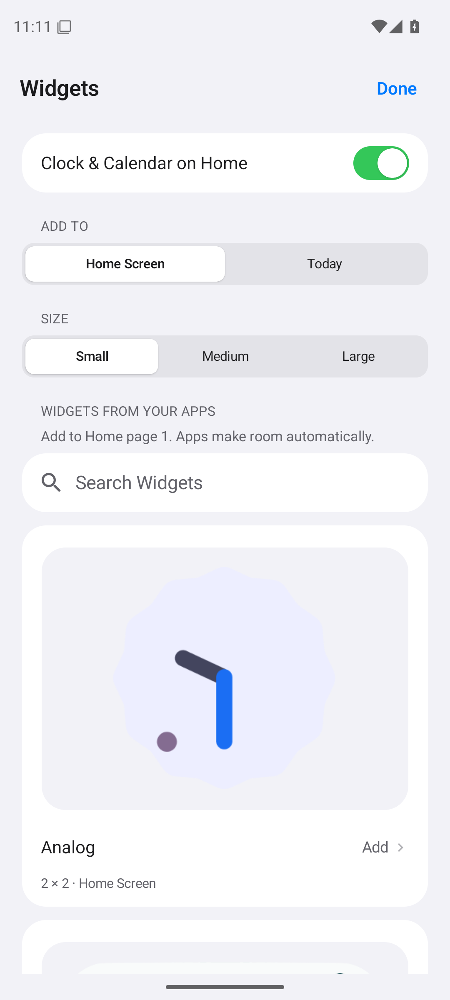

# Vitreo Launcher

An Android home screen inspired by iOS, with glass surfaces, a four-column grid,
App Library, an optional Cyberpunk HUD theme and native Android widgets. Android 12 or newer. English by default;
no accounts, ads, analytics, root or accessibility service.

[Download the signed APK](https://github.com/sPROFFEs/vitreo-launcher/releases/latest)
· [Lock screen / GrapheneOS](docs/LOCK_SCREEN.md) · [Changes](CHANGELOG.md) · [Build](BUILDING.md) · [Privacy](PRIVACY.md)

<p>
  
  
  
  
</p>

[Screenshots](docs/screenshots/PROVENANCE.md) from Android emulators. Each CI run also keeps screenshots, a motion
recording and test reports for its exact commit.

## Use Vitreo

Install the release APK and select **Vitreo** as your default Home app in Android
Settings. Keep your system launcher installed so you can switch back at any time.
Updates use the same app ID and signing key; install the newer APK over the old one.
Debug and Preview are separate apps with separate data and test signatures.

When Vitreo is the default launcher, **Wallpaper → Sync with Android Home** keeps
the system Home wallpaper and Vitreo's backdrop aligned, including dimming and
Cyberpunk styling. This is enabled by default and can be turned off. Returning
from Recents brings Home icons inward from the screen edges while the wallpaper
stays on Android's own surface; Reduce Motion removes the icon arrival effect.

- **Home:** swipe between pages. Four app columns, folders and a four-slot glass dock.
- **Today:** swipe right from the first Home page for widgets and recent suggestions.
  Tap **Edit** to reorder or remove built-in cards and restore them later.
- **Control Center:** swipe down briefly in the upper-right area, below Android's
  status bar, on Home, Today or App Library. Today also has a dedicated button.
  Swipe up from the panel's bottom handle to close it. Enable/disable it in
  **Settings → Control Center**.
- **Search:** tap Search or swipe down. Search locally by app name or package.
- **App Library:** swipe past the last Home page. Open a category or use the alphabetical index.
- **Uninstalling:** confirmed removals clear Home, Dock, folders and suggestions automatically. APK updates preserve placement.
- **App actions:** hold an icon for shortcuts, folders, Dock and Edit Home Screen.
- **Settings:** use the gear in Today or in Edit Home Screen. Choose icon size up to
  84 dp, icon artwork/treatment, appearance, wallpaper and Motion & Glass options.
- **Wallpaper:** use a built-in background or a local photo. Pinch, pan, Fit, Fill and
  Reset let you frame it before saving; the original remains available for later edits.

## Widgets on Home and Today

1. Hold an empty Home area, or choose **Edit Home Screen** from an app's menu.
2. Tap **Add Widgets**. Choose **Home Screen** or **Today**, and a size for Home.
3. Find a widget and tap **Add**. Accept Android's binding/configuration dialog if requested.
4. Tap the **…** below a widget to change its size or page, move it between Home
   and Today, reorder it within Today, or remove it. In edit mode, hold and drag a Home widget; pause at an
   edge to change pages. A trailing page is available during a widget drag.

**Configure Widget** is available when the provider supports reconfiguration.

Apps make room around widget rectangles. Page and size survive app restarts;
existing Today widgets stay in Today after upgrading. Up to eight native widgets
can be added. Large provider layouts are fitted proportionally and clipped inside
rounded native containers. Catalog previews are passive and never bind a widget.
Widget IDs belong to this installation and are excluded from portable backups.

**Today → Edit** moves Clock & Calendar, Suggestions and the native-widget group
using handles or arrows. Remove either built-in card, restore it with its switch
or **Restore Default Cards**, or move Clock & Calendar to Home. Removing Today's
copy leaves Home's setting intact. Home's Clock & Calendar can also be toggled
separately in Settings. Native widgets come
from installed Android apps; their content and network use belong to their providers.

## Control Center

Connectivity and media cards, Focus, appearance, vertical brightness/volume
sliders and editable shortcuts follow the proportions of iOS 26, with a diffuse
wallpaper backdrop and original control symbols. Swipe vertically
or tap the side rail for **Favorites**, **Media** and **Connectivity**. Tap **+** to
edit the shortcut grid: remove with **−**, resize from its corner, or hold and drag
to reorder. **Add a Control** opens a searchable picker with accessible ordering
arrows; **Restore Default Controls** resets the shortcuts and sizes.

Media volume changes Android's actual music stream. Enable **Connect media player**
and authorize notification access in Android Settings for real track details, artwork,
play/pause, supported previous/next actions and seeking. Without this optional access,
system media keys are available while audio is playing. Flashlight
uses the public torch API when the device makes it available. Timer, Calculator,
Camera and Music launch suitable installed apps. Network, rotation, Focus, cast,
NFC and battery controls open Android's settings or panels.

**Home brightness** affects Vitreo's window; **Use system brightness** restores
Android's value. It does not change other apps' brightness. Disabling Vitreo's
Control Center removes its gesture/button; Android's Quick Settings stays available.
**Settings → Control Center → Home integration** also offers a custom Home status
bar and Notification Center, independently off by default. The top-right 38% opens
controls; the top-left 62% opens notifications when enabled. Adjust/test the gesture
area in Settings. The pull follows your finger and short reversed pulls cancel.
Notification Center displays real alerts with expansion, actions and dismissal;
notification access is explicitly authorized in Android and content stays in memory.
The custom bar shows time, battery and network connection. It replaces the status
bar **inside Home only**; other apps and Android's physical top-edge gesture keep
system behavior.
See [Control Center](docs/CONTROL_CENTER.md) for platform behavior and references.

## Themes and icon packs

Open **Settings → Themes & Icons** for **iOS** or **Cyberpunk**. Cyberpunk uses
dark angular panels, red/cyan HUD details, line icons, digital Clock & Calendar,
and brief panel sweeps. **Classic** preserves the original quiet appearance.
Choose **Immersive** for rain, drifting light, scanning HUD accents and animated
panel edges. **Neon Rider** and **Digital Dusk** are included original wallpapers;
select one separately to keep full control of your current photo. Ambient effects
stop when Home is obscured or loses focus, and respect Reduce Motion/Battery Saver.
iOS remains the default; changing theme keeps your layout.

**Neural Pearl**, **Neural Carbon** and **Neural Crimson** are also bundled, from
the maintainer's supplied images. All five Cyberpunk images are available for Home
and the independently configurable lock screen, without downloading anything.

**Settings → Wallpaper → Dim wallpaper** controls brightness in both Classic and
Immersive / Neon city, for photos and included wallpapers. There is no extra fixed
dark layer in Cyberpunk; the setting also applies to Android Home synchronization.

Select an installed ADW/Nova-compatible icon pack from the same page. To choose an
alternate for one app, hold it and use **More → Change Icon**. **Current theme**
contains the 23 built-in icons, so you can give any gallery app the Photos icon
or assign any other theme icon without installing a pack. These choices follow
iOS/Cyberpunk when you change themes, and survive backups. **Use Default** resets
that app's override. Installed icon packs remain available under **Icon source**.
Missing artwork
falls back to the theme/native icon. See [Cyberpunk & icon packs](docs/CYBERPUNK.md)
for coverage, supported formats, credits and motion controls.

## Motion and glass

Panels open from their source and retain their content during dismissal. Dragging
can cancel or complete a close using distance and velocity. Press feedback, icon
editing and segmented controls animate in the drawing layer; Home cells spring
into their new positions when widget space changes. The Dock follows the pager's
fractional position in both directions; Home keeps the same grid space throughout. The design references and
implementation choices are documented in [Motion](docs/MOTION.md).

Android 13+ uses a custom AGSL effect over Vitreo's own wallpaper. Android 12 uses
a frosted fallback. **Battery Saver and Reduce Motion limit the effect**; Reduce
Transparency uses opaque panels. Settings explains which mode is active. A textured
wallpaper makes refraction easier to see. Vitreo does not use UIKit or capture other apps.

Android controls cross-app transitions, Recents, notifications, the keyboard and
secure keyguard. Vitreo coordinates its desktop and passes the tapped icon's bounds
to the system; it cannot replace iOS's compositor or Android's system launcher integration.

## Optional lock screen

**Settings → Lock Screen** provides iOS-inspired and Cyberpunk styles, a clock
editor, glass lettering, independent wallpapers, battery/alarm widgets and a
full-screen preview. **Customize Lock Screen** edits a draft with Cancel / Done:
six font designs, color, Glass / Solid, vertical clock resizing, wallpaper
thumbnails, dimming and accessory switches. Cyberpunk has Classic and optional Immersive HUD motion.
It is **off by default** and requires Vitreo to be the default Home and an Android
PIN, password or pattern to be configured.

This is a visual surface over Android's secure keyguard. Swipe up in the central
clock / accessories area or tap **Use PIN or password** to request **Android / GrapheneOS authentication**; Vitreo never handles credentials.
**Fingerprint shortcut** is optional and hidden by default. Enable it to show
**System unlock**, which reveals Android's real keyguard and fingerprint UI when
its policy permits it; it does not start a second app-authentication session.
System / Emergency and Back also return to Android's screen. Secure camera uses the
secure-camera intent. Notification contents and third-party widgets are not
exposed on this surface. No Google Play services or additional permissions are needed.

Android retains its screen after reboot, process death or delayed locking. There
is no persistent service to force the custom surface to appear. Activation stays
on the device and is excluded from backups. See [setup, limitations and Pixel /
GrapheneOS testing](docs/LOCK_SCREEN.md). Physical GrapheneOS biometric behavior
requires device testing; emulator results are not a substitute.

Quick power cycles prepare immediately and allow one immediate recovery within
600 ms of screen-off, provided Android has already locked. The header adapts to
the device's status/camera insets. Rounded iOS and angular Cyberpunk status glyphs
are shared with the optional Home/Notification Center bars and Control Center.

## Development

With JDK 17, Python 3.10+ and Android SDK 35 configured:

```sh
python3 scripts/check_project.py
python3 -m unittest discover -s tests -v
bash gradlew --no-daemon :app:testDebugUnitTest :app:lintDebug :app:assembleDebug :app:lintPreview :app:assemblePreview
```

Preview APK: `app/build/outputs/apk/preview/app-preview.apk`.
See [BUILDING.md](BUILDING.md) for pinned tools, emulator tests and release setup;
[Architecture](docs/ARCHITECTURE.md) for storage and layout;
[Testing](docs/TESTING.md) for physical-device checks.

A push to `main` runs source checks, API 31/35 device tests, JVM tests and lint,
then builds and verifies the signed, optimized release. Numeric versions publish
as normal releases. Published tags and assets are never overwritten: bump
`version.properties` with `python3 scripts/bump_version.py X.Y.Z` before the next
release. Signing setup and update continuity are in [SIGNING.md](docs/SIGNING.md).

## Troubleshooting

If an app is missing, use **Settings → Refresh apps** and search by name or package.
The catalog covers the current Android user. Work profiles, Secure Folder and
Private Space are not combined into this catalog.

For a bug report, include the device, Android version, Vitreo version, exact steps
and **Settings → About Vitreo → Save diagnostics**. Review the exported file before
sharing it. See [Security](SECURITY.md) for private reports.

## License and credits

Vitreo is MIT licensed. Selected geometry, motion roles and menu placement adapt
[Folio](https://github.com/McCal-Codes/folio), with its MIT notice retained.
Twenty-two bundled app images come from [SVG Stack](https://svgstack.com/collections/apple-ios-icon-set)
under CC BY 4.0; Contacts uses original address-book artwork. Clock and Calendar
show live local time/date. Other apps retain their own icons. All source URLs,
hashes and notices are in [THIRD_PARTY_NOTICES.md](THIRD_PARTY_NOTICES.md) and in
the APK's Open source licenses screen. Apple/iOS are design references; Vitreo is
an independent Android project.

The optional Cyberpunk theme includes 23 [Arcticons](https://github.com/Arcticons-Team/Arcticons)
app glyphs (CC BY-SA 4.0), 13 [CYBERCORE](https://github.com/sebyx07/cybercore-css)
control glyphs (MIT) and [Rajdhani](https://github.com/google/fonts/tree/main/ofl/rajdhani)
fonts (SIL OFL 1.1). Commercial icon-pack artwork and game assets are not bundled.
