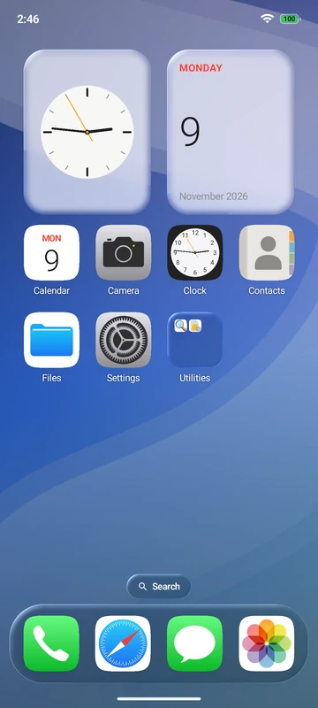
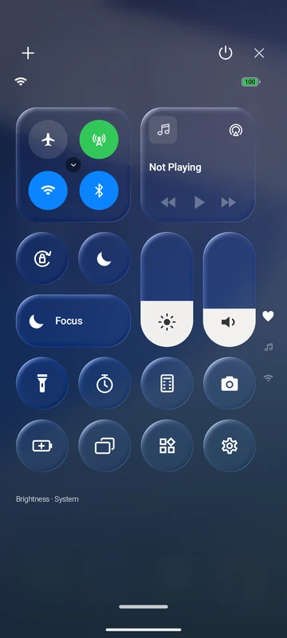
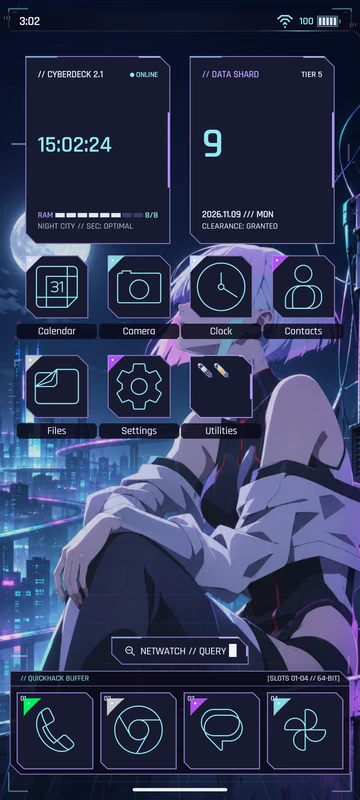
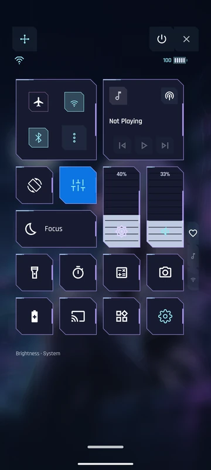

# Vitreo Launcher

An Android launcher with iOS-inspired glass, an iOS 16 Classic style and a
Cyberpunk HUD. Android 12+, English interface, no accounts, ads or analytics.
Google Play services, root and accessibility services are not required.

**[Download the signed APK](https://github.com/sPROFFEs/vitreo-launcher/releases/latest)**
· [User guide](docs/guide/GETTING_STARTED.md)
· [All documentation](docs/README.md)
· [Changelog](CHANGELOG.md)

  
  
  
  

Real captures of the signed release. [Full gallery and capture details](docs/screenshots/README.md).

## What you can do

- **Make Home yours:** live icon rearrangement, drag-to-group folders, App Library,
  per-app theme icons and installed icon packs. Add Android widgets to Home or Today.
- **Choose a look:** iOS 26 glass, quieter iOS 16 frost, or Cyberpunk with faction
  palettes and David, Lucy, Rebecca and Kiwi wallpapers. Motion and transparency
  controls remain available in every theme.
- **Use optional panels:** Control Center, Notification Center, a shared Home/Lock
  status bar and a notification island above other apps.
- **Customize the lock screen:** fonts, colors, clock height and independent
  wallpapers, with Android authentication. Person-over-clock depth is experimental
  and off by default.
- **Keep up to date:** optional RSS news in Today and verified updates from stable
  GitHub releases. Neither needs a Google account.

## Get started

1. Install the APK from **Releases**, then select **Vitreo** as Android's default
   Home app. Keep the system launcher installed.
2. Swipe right to **Today**, then tap the gear for **Settings**. Choose
   **Themes & Icons** to change the look.
3. Hold an app for actions, or move it to start arranging Home. In edit mode,
   drag immediately; hold over another icon to create a folder.

Updates preserve the app identity and signing key. Use **Settings → Software
Update**, or install a newer release APK over the current one. Debug and Preview
are separate development apps.

Vitreo customizes its own surfaces. Android retains Recents, system gestures and
secure authentication; the optional status bar does not replace SystemUI globally.
Pixel / GrapheneOS setup and limits are covered in the [lock screen guide](docs/guide/LOCK_SCREEN.md).

## Documentation and development

[Home & widgets](docs/guide/HOME_AND_WIDGETS.md)
· [Themes & wallpapers](docs/guide/THEMES.md)
· [Panels & notifications](docs/guide/PANELS.md)
· [Troubleshooting](docs/guide/TROUBLESHOOTING.md)

[Build](BUILDING.md) · [Architecture](docs/development/ARCHITECTURE.md)
· [Tests](docs/development/TESTING.md) · [Release process](docs/development/RELEASING.md)

## Privacy and credits

App layout, photos and preferences stay on the device. Optional news, updates,
notification access and overlays are described in [Privacy](PRIVACY.md).
See [Security](SECURITY.md) for reporting guidance.

MIT licensed. Artwork, fonts and adapted material retain their own licenses:
[credits and third-party notices](THIRD_PARTY_NOTICES.md). Vitreo is independent
of Apple, GrapheneOS and CD PROJEKT RED.
