# Screenshot gallery

[Documentation](../README.md) · [Capture provenance](PROVENANCE.md)

Fresh captures of the **signed Vitreo 0.10.14 release** on an Android 15 emulator.
Click a preview for its full 1080 × 2400 image. These are actual app screens,
with stock AOSP apps, not mockups or test-provider layouts. Installed apps and
available widgets differ on your phone.

## iOS 26

Blue wallpaper, custom Home status bar, 72 dp artwork and an example Utilities
folder. Browser artwork is assigned using the theme's per-app icon override.

| Home | App Library | Control Center |
| --- | --- | --- |
| <a href="ios26-home.webp">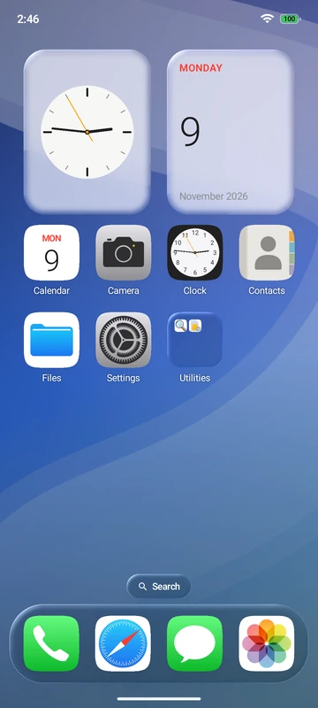</a> | <a href="ios26-library.webp">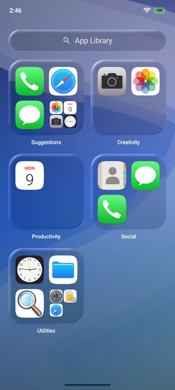</a> | <a href="ios26-controls.webp">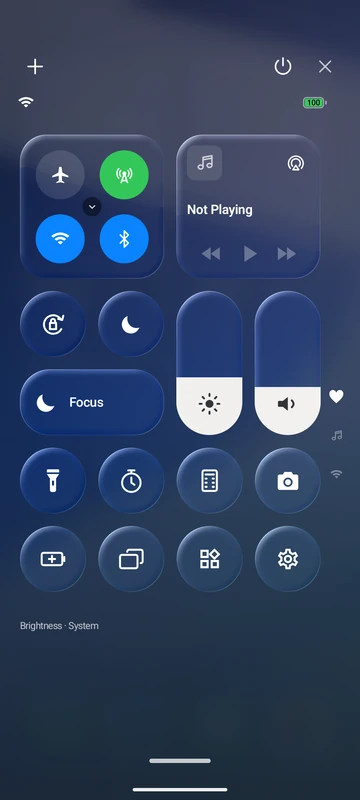</a> |

| Home folder | Widget catalog | Lock customization |
| --- | --- | --- |
| <a href="ios26-folder.webp">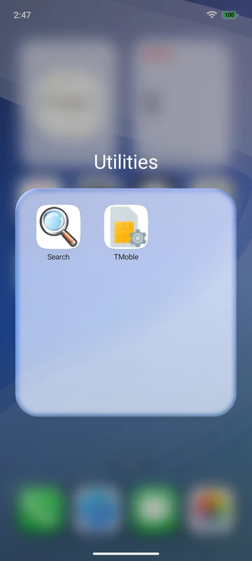</a> | <a href="ios26-widgets.webp">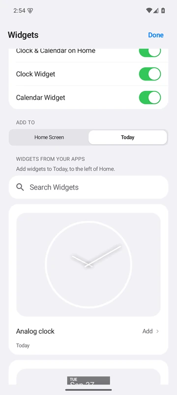</a> | <a href="ios26-lock-editor.webp">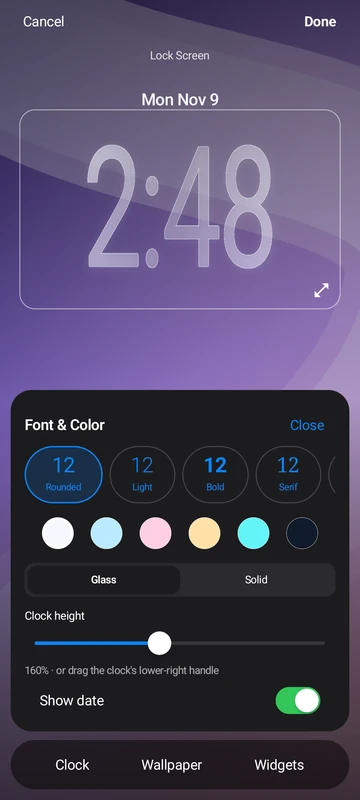</a> |

The widget catalog shows previews from installed Android providers. The Lock
Screen image is the **unlocked customization editor**; it does not demonstrate
an authenticated/locked screenshot or a successful depth cutout. The selected
Orchid lock wallpaper is independent of Home.

[See the grouped Settings page](ios26-settings.webp).

## iOS 16 Classic

Orchid wallpaper, uniform frost and the compact rounded-square Control Center.
The underlying arrangement and icon size stay the same.

| Classic Home | Classic Control Center |
| --- | --- |
| <a href="ios16-home.webp">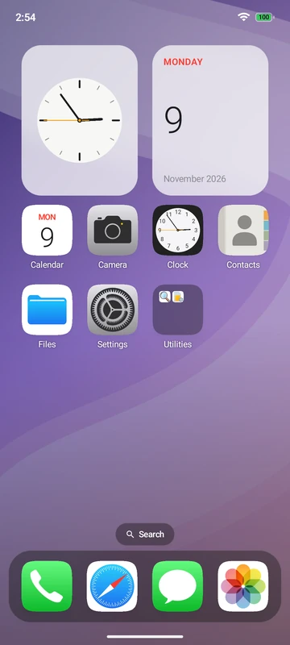</a> | <a href="ios16-controls.webp">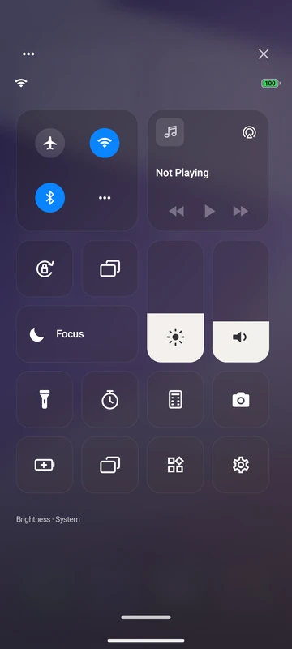</a> |

## Cyberpunk

Lucy uses her Moonlight wallpaper and cyan/pearl/violet palette with Immersive
and modular HUD effects. Control Center uses the same palette and angular controls.

| Lucy Home | Cyberpunk App Library | Cyberpunk Control Center |
| --- | --- | --- |
| <a href="cyber-lucy-home.webp">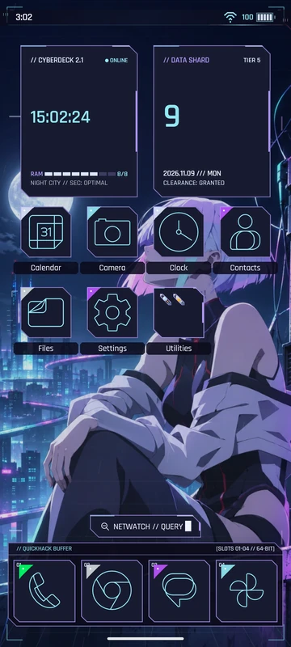</a> | <a href="cyber-library.webp">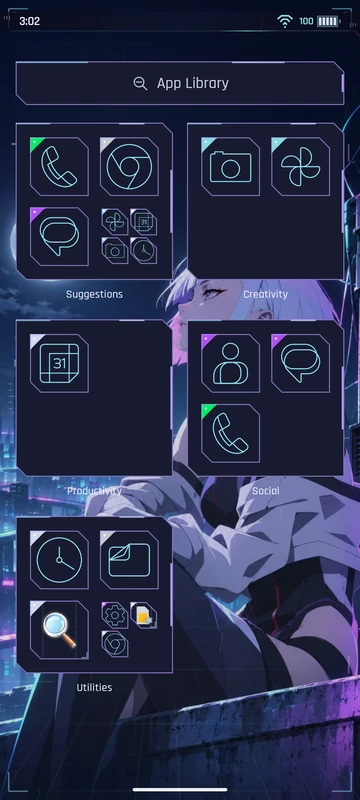</a> | <a href="cyber-controls.webp">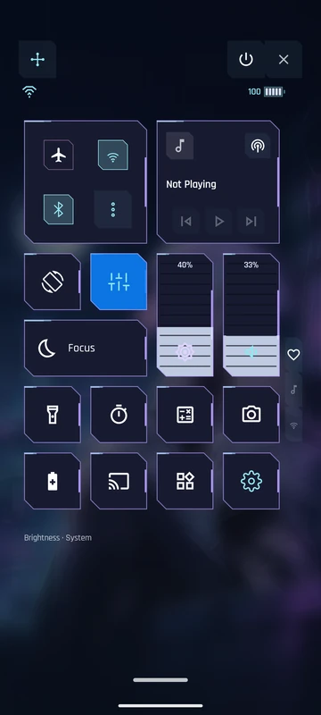</a> |

| David · Afterimage | Quiet HUD · Neon Rider | Lucy Lock Screen preview |
| --- | --- | --- |
| <a href="cyber-david-home.webp">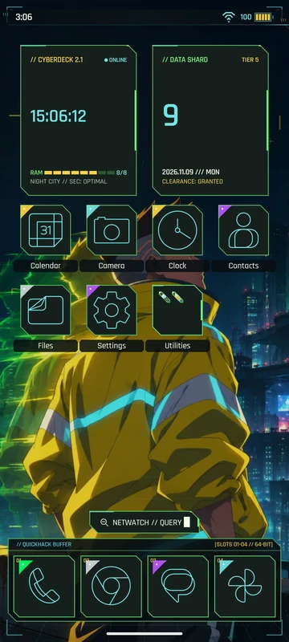</a> | <a href="cyber-quiet-home.webp">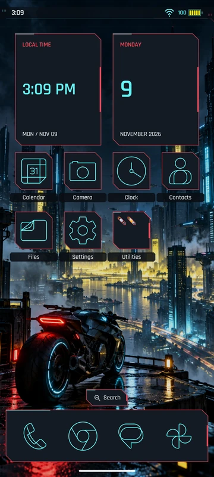</a> | <a href="cyber-lock.webp">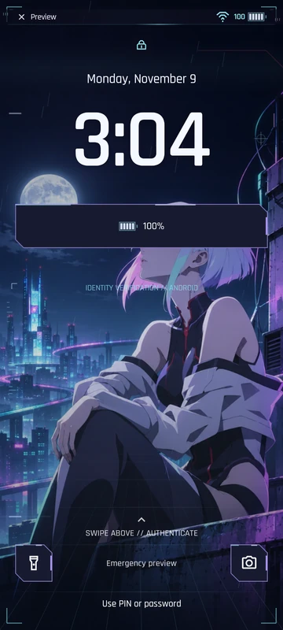</a> |

David uses yellow/green accents and his own wallpaper. Quiet HUD has ambient and
modular decoration disabled, showing the restrained alternative. The Lucy lock
image is an **unlocked full-screen preview**, with custom status bar and HUD clock.

Media panels have no active player, and no private notifications or invented live
alerts are staged. The images show available controls rather than implying
unsupported Android radio or authentication capabilities.

## Reproduce or refresh

[Capture details, profiles and commands](PROVENANCE.md) document the exact APK,
configuration and lossless image pipeline. Feature instructions are in
[Themes](../guide/THEMES.md), [Panels](../guide/PANELS.md),
[Widgets](../guide/HOME_AND_WIDGETS.md) and [Lock Screen](../guide/LOCK_SCREEN.md).
